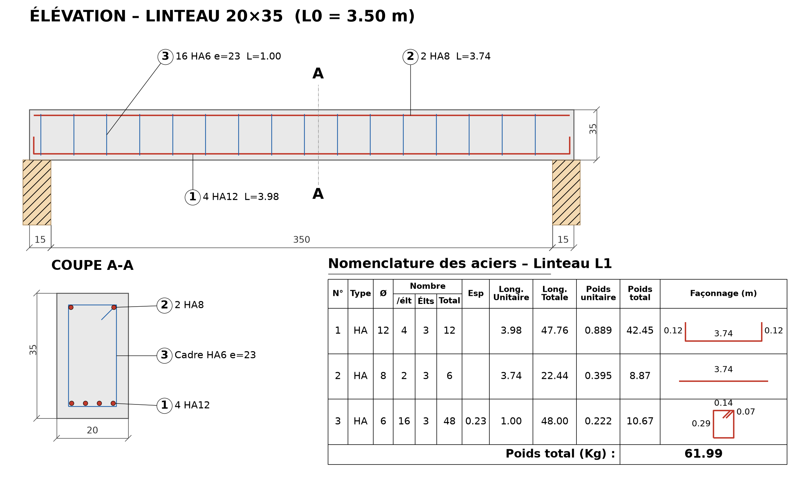

# Ferraillage EC2

**Calcul, vérification et plans de ferraillage des linteaux et raidisseurs en béton armé selon l'Eurocode 2.**

Logiciel gratuit pour Windows. Saisissez la géométrie, les matériaux et les charges : Ferraillage EC2 calcule le ferraillage, vérifie l'élément, rédige la note de calcul Word et dessine le plan de ferraillage avec la nomenclature des aciers, exportable en PDF ou en DWG.

## Fonctionnalités

### Linteau (poutre sur deux appuis)
- Portée de calcul, charges ELU / ELS (EN 1990)
- Flexion simple : μ, As, As,min, As,max, choix des barres, espacement
- Effort tranchant : VRd,c, VRd,max, cadres et espacement
- Ancrage sur appui, droit ou avec retours
- Flèche par le rapport portée / hauteur utile (§7.4.2)

### Raidisseur (poteau / chaînage vertical)
- Élancement et effets du second ordre (méthode de la courbure nominale)
- Diagramme d'interaction N-M
- Dispositions constructives EC2 §9.5
- Option maçonnerie chaînée EN 1998-1 §9.5.3

### Documents produits
- **Note de calcul Word** : hypothèses, formules détaillées avec valeurs, tableau des vérifications (OK / NON), ferraillage retenu
- **Plan de ferraillage** : élévation, coupe A-A avec repères, cotes
- **Nomenclature des aciers** : nombre par élément × nombre d'éléments, espacement, longueurs unitaire et totale, poids unitaire et total, schéma de façonnage coté
- **Export** en PDF, PNG, **DWG** (si AutoCAD est installé) ou **DXF** (AutoCAD, ZWCAD, BricsCAD, DraftSight…)

## Installation

1. Téléchargez `Setup_Ferraillage_EC2_1.0.0.exe` dans la section **Releases**.
2. Lancez-le. Si Windows affiche « Windows a protégé votre ordinateur », cliquez sur **Informations complémentaires**, puis **Exécuter quand même** (le logiciel n'est pas encore signé numériquement).
3. Suivez l'assistant. L'installation ne demande pas de droits administrateur.

Configuration requise : Windows 10 ou 11, 64 bits. AutoCAD est facultatif : il ne sert qu'à l'export DWG.

## Utilisation

1. Renseignez le projet et le repère de l'élément (par exemple L1).
2. Saisissez les données dans l'onglet **Linteau** ou **Raidisseur**.
3. **Calculer** : détail des calculs et vérifications.
4. **Dessin de ferraillage** : plan et nomenclature, à enregistrer en PDF ou PNG.
5. **Plan AutoCAD (DWG)** : plan de tous les éléments cochés « Inclure ».
6. **Générer la note Word** : note de calcul complète.

## Hypothèses

- EN 1992-1-1, valeurs recommandées (γc = 1,5 ; γs = 1,15 ; αcc = 1,0), sans Annexe Nationale
- Combinaisons : ELU 1,35 G + 1,5 Q ; ELS caractéristique G + Q
- Linteau calculé sur deux appuis simples
- Raidisseur : flexion vérifiée selon la petite dimension avec la totalité du moment
- Crochets des cadres : 135°, 10 Ø (minimum 7 cm) ; attentes des raidisseurs : 50 Ø

## ⚠️ Avertissement

Ferraillage EC2 est un **outil d'aide au calcul**. Les résultats, notes, plans et nomenclatures doivent être **vérifiés et validés par un ingénieur qualifié** avant toute utilisation sur un projet réel. Le logiciel est fourni « tel quel », sans garantie. Voir [LICENCE.txt](LICENCE.txt).

## Versions

- **1.0.0** : première version publique
